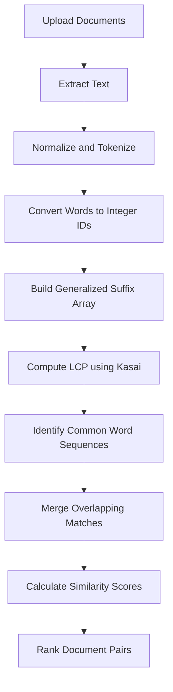

# DOCS_SIMILARITY — Backend

A Java Spring Boot backend that analyzes documents and identifies shared word sequences using Data Structures and Algorithms (DSA).

## Features

- Supports TXT, PDF, and DOCX documents.
- Extracts and tokenizes document text.
- Builds a Generalized Suffix Array using the prefix-doubling algorithm.
- Uses the Kasai LCP algorithm to identify common word sequences.
- Merges overlapping matches.
- Calculates similarity scores and ranks document pairs.
- Includes unit and integration tests.

## Processing Flow



## Algorithms Used

**1. Generalized Suffix Array**  
Uses prefix doubling to organize word sequences from multiple documents efficiently.

**2. Kasai LCP Algorithm**  
Computes the Longest Common Prefix between adjacent suffixes in the suffix array.

**3. Common Sequence Merging**  
Combines overlapping matches to avoid reporting redundant sequences.

**4. Similarity Scoring**

Similarity is calculated using the shared word count and the total word count of both documents:

`Similarity = (2 × Shared Words / (Words in A + Words in B)) × 100`

## Technology Stack

- **Language:** Java
- **Framework:** Spring Boot
- **Build Tool:** Maven
- **PDF Processing:** Apache PDFBox
- **DOCX Processing:** Apache POI
- **Testing:** JUnit and Spring Boot testing tools

## Project Structure

```text
src/
├── main/
│   ├── java/com/docs_similarity/
│   │   ├── config/
│   │   ├── controller/
│   │   ├── dsa/
│   │   ├── extraction/
│   │   ├── model/
│   │   ├── service/
│   │   └── util/
│   └── resources/
└── test/
    └── java/com/docs_similarity/
```

## Run Locally

**Prerequisites:** Java and the Maven wrapper included in this repository.

Run the backend using:

```bash
./mvnw spring-boot:run
```

Run the tests using:

```bash
./mvnw test
```

## Limitations

- Detects textual overlap rather than semantic similarity.
- Does not perform AI-based plagiarism detection.
- Scanned PDFs requiring OCR are not supported.

---

**Project:** DOCS_SIMILARITY  
**Focus:** Document similarity analysis using Data Structures and Algorithms
